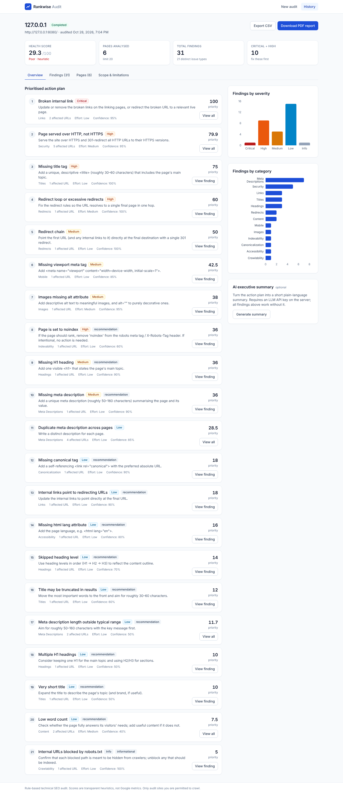
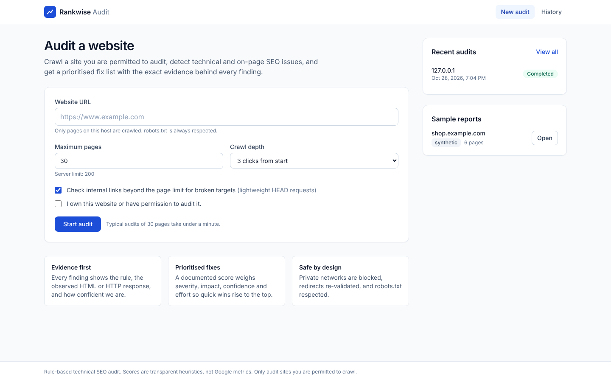
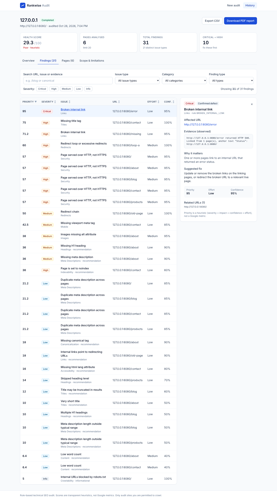
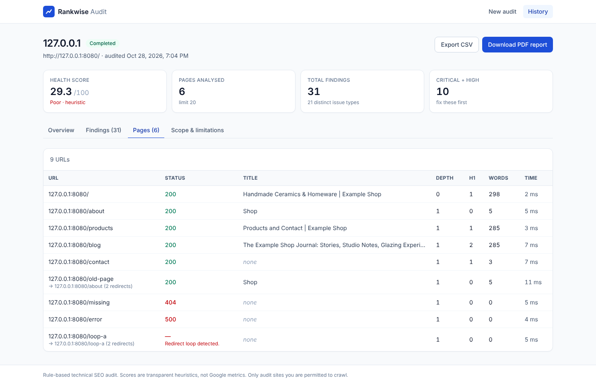
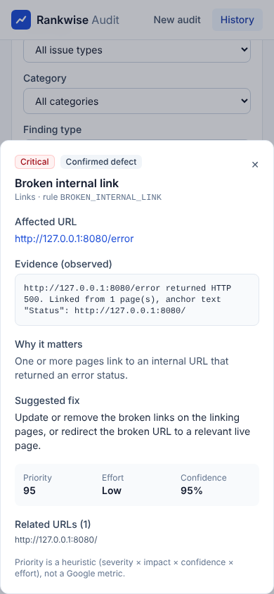

# Rankwise Audit — SEO Audit & Fix Prioritizer

Crawl a website you are permitted to audit, detect technical and on-page SEO issues, and get a **prioritised fix list where every finding shows the exact evidence** — the HTML value or HTTP response it was based on, the rule that produced it, a suggested correction, estimated effort and confidence.



## The problem

SEO crawlers often dump hundreds of warnings with no indication of which matter, mix style guidelines with real defects, and hide *why* something was flagged. Rankwise Audit focuses on three things:

1. **Evidence** — every finding is traceable to a rule ID and an observed value.
2. **Honesty** — confirmed defects are separated from best-practice recommendations; scores are documented heuristics, not Google metrics.
3. **Prioritisation** — a transparent formula ranks fixes by severity, impact, confidence and effort.

## Features

- **Safe crawling**: URL validation (http/https only), SSRF protection on every redirect hop, robots.txt (RFC 9309), configurable page and depth limits, timeouts, response-size cap, concurrency limit, crawl delay, redirect-loop detection, de-duplication.
- **39 SEO rules** ([catalogue](docs/RULES.md)): missing/empty/duplicate/long/short titles; missing/empty/duplicate/out-of-range meta descriptions; missing, empty or multiple H1s; skipped heading levels; missing, multiple, cross-domain or broken canonicals; images without alt; broken internal links (crawled or HEAD-checked); 4xx/5xx pages; redirect chains and loops; links to redirecting URLs; noindex/nofollow (meta and `X-Robots-Tag`); missing robots.txt; missing or broken XML sitemap; robots-blocked URLs; HTTP-only pages; mixed content; missing viewport; missing `lang`; low word count; oversized HTML.
- **Five severities** (Critical → Info) and a **defect / recommendation / informational** type on every finding.
- **Prioritised action plan** with a [documented scoring formula](docs/SCORING.md) and a heuristic health score.
- **Dashboard**: summary cards, live crawl progress, severity and category charts (clickable), sortable findings table, filters (search, severity, issue type, category, finding type), clear filters, evidence detail panel, crawled-pages table, scope & limitations tab, audit history.
- **Exports**: CSV (spreadsheet-formula-injection safe) and a PDF report with audit date, domain, pages analysed, summary, action plan, findings with evidence, and limitations.
- **Optional AI executive summary** (Anthropic or any OpenAI-compatible API). The audit works fully without a key.
- **Sample report** bundled and clearly labelled **synthetic**, plus a CLI to produce a real report for any site you may audit.

## Tech stack

| Layer | Choice |
|---|---|
| Frontend | React 19, TypeScript, Vite, Tailwind CSS v4, Recharts, React Router |
| Backend | Python, FastAPI, HTTPX (async), BeautifulSoup + lxml, Pydantic v2 |
| Storage | SQLite (one JSON document per audit) |
| Reports | ReportLab (PDF), stdlib csv |
| Tests | Pytest + pytest-asyncio with `httpx.MockTransport` fixtures; Vitest + React Testing Library |

See [docs/ARCHITECTURE.md](docs/ARCHITECTURE.md) for the structure, data flow and security model.

## Quick start (local)

Requirements: Python 3.12+ and Node.js 20+.

```bash
# 1. Backend
cd backend
python -m venv .venv && source .venv/bin/activate      # Windows: .venv\Scripts\activate
pip install -r requirements-dev.txt
cp .env.example .env
uvicorn app.main:app --reload --port 8000              # API docs: http://localhost:8000/docs

# 2. Frontend (new terminal)
cd frontend
npm install
npm run dev                                            # http://localhost:5173 (proxies /api to :8000)
```

Open http://localhost:5173, enter a URL, tick the permission box and start the audit. Open **Sample reports → shop.example.com** to explore the synthetic demo without crawling anything.

To audit a site running on your own machine (e.g. `http://localhost:3000`), set `ALLOW_PRIVATE_HOSTS=true` in `backend/.env` — **local development only**.

### Single-process mode (as deployed)

```bash
cd frontend && npm run build && cp -r dist ../backend/static
cd ../backend && uvicorn app.main:app --port 8000      # UI and API on http://localhost:8000
```

## Testing

```bash
cd backend && pytest -q            # 109 tests
cd frontend && npm test            # 29 tests
cd frontend && npm run build       # type-check + production build
```

All of these were run for this submission — see [TEST_RESULTS.md](TEST_RESULTS.md) for the exact results and what was and was not verified.

## Producing a real-company demo

The development sandbox used to build this project had no general internet access, so **no real website was crawled and no real-company findings are included**. The bundled sample (`shop.example.com`) is genuine output of the crawler and rules run against a fictional in-memory fixture site, and is labelled *synthetic* in the UI, JSON and PDF.

To generate an authentic report on a machine with internet access (only for sites you are permitted to audit):

```bash
cd backend
python -m scripts.run_audit https://www.example-company.com --max-pages 25 --max-depth 2
```

This writes `docs/demo/<domain>-<date>.{json,csv,pdf}` and copies the JSON into `backend/demo_data/`, so it appears under **Sample reports** labelled *live*, with its real audit timestamp, tested URLs, crawl status and limitations.

## API

Interactive docs at `/docs` (OpenAPI).

| Method | Path | Description |
|---|---|---|
| GET | `/api/health` | Health check |
| GET | `/api/config` | Crawl limits and whether AI is enabled |
| POST | `/api/audits` | Start an audit `{url, max_pages?, max_depth?, check_uncrawled_links?}` → `202 {id}`; `400` unsafe URL; `422` invalid input; `429` too many running |
| GET | `/api/audits` | List audits (newest first) |
| GET | `/api/audits/{id}` | Full audit: status, progress, summary, findings, action plan, pages, limitations |
| POST | `/api/audits/{id}/cancel` | Cancel a running audit (partial results are kept) |
| DELETE | `/api/audits/{id}` | Delete an audit |
| GET | `/api/audits/{id}/export.csv` | Findings as CSV |
| GET | `/api/audits/{id}/export.pdf` | PDF report |
| POST | `/api/audits/{id}/ai-summary` | Optional AI summary; `503` when no LLM is configured |
| GET | `/api/demos` · POST `/api/demos/{file}/load` | Bundled sample reports |

## Configuration

All settings are environment variables (see [`backend/.env.example`](backend/.env.example)): crawl ceilings (`MAX_PAGES_LIMIT`, `MAX_DEPTH_LIMIT`), `REQUEST_TIMEOUT_S`, `MAX_RESPONSE_BYTES`, `CONCURRENCY`, `CRAWL_DELAY_S`, `MAX_AUDIT_DURATION_S`, `LINK_CHECK_LIMIT`, `USER_AGENT`, `CORS_ORIGINS`, `DATABASE_PATH`, and the optional `LLM_PROVIDER` / `LLM_API_KEY` / `LLM_MODEL` / `LLM_BASE_URL`. The frontend reads `VITE_API_BASE_URL` only when hosted separately from the API.

## Security considerations

Summary (details in [ARCHITECTURE.md](docs/ARCHITECTURE.md#security-model-ssrf-and-crawling-safety)): only http/https; private, loopback, link-local, CGNAT, reserved and cloud-metadata destinations are blocked after DNS resolution and on every redirect; post-connect peer-IP check; strict size/time/concurrency limits; robots.txt always respected; same-host scope; no JavaScript execution or access-control bypass; crawled text is escaped in PDFs, neutralised in CSVs and rendered as plain text in the UI; the LLM never receives raw page content; secrets stay on the server. Users must confirm they are permitted to audit the site.

## Known limitations

- **No JavaScript rendering.** Content injected client-side (common in SPAs) is invisible to the crawler; such pages may show missing titles/H1s or low word counts. Mitigated by wording and confidence, not solved.
- **Pixel-width truncation** of titles and descriptions is approximated by character counts.
- **Bot protection** (Cloudflare challenges, WAFs) can make pages appear as errors; these are reported with lower confidence and should be re-tested.
- **Same host only** — subdomains are treated as separate sites; external links are not checked.
- **In-process jobs** — audits run inside the API process; a restart cancels running audits. Free hosting with an ephemeral disk loses audit history on restart (bundled samples persist).
- **DNS rebinding** is mitigated by the post-connect peer check but not fully eliminated when an outbound proxy is configured (`USE_ENV_PROXY=true`).
- No performance metrics (Core Web Vitals), structured-data validation or hreflang checks yet.

## Deployment

Recommended: a single Docker web service on Render's free plan (`render.yaml` included). See [DEPLOYMENT.md](DEPLOYMENT.md) for step-by-step instructions, environment variables, free-tier caveats and an alternative split frontend/backend setup.

## Publishing to GitHub

```bash
cd seo-audit
git remote add origin https://github.com/<your-username>/seo-audit.git
git branch -M main
git push -u origin main
```

## Project docs

[PROGRESS.md](PROGRESS.md) · [TEST_RESULTS.md](TEST_RESULTS.md) · [DEPLOYMENT.md](DEPLOYMENT.md) · [docs/ARCHITECTURE.md](docs/ARCHITECTURE.md) · [docs/RULES.md](docs/RULES.md) · [docs/SCORING.md](docs/SCORING.md) · [docs/INTERVIEW_NOTES.md](docs/INTERVIEW_NOTES.md)

## Screenshots

| | |
|---|---|
|  |  |
|  |  |

Screenshots were captured with headless Chromium from the running application auditing the fixture site served over a real local HTTP server.
